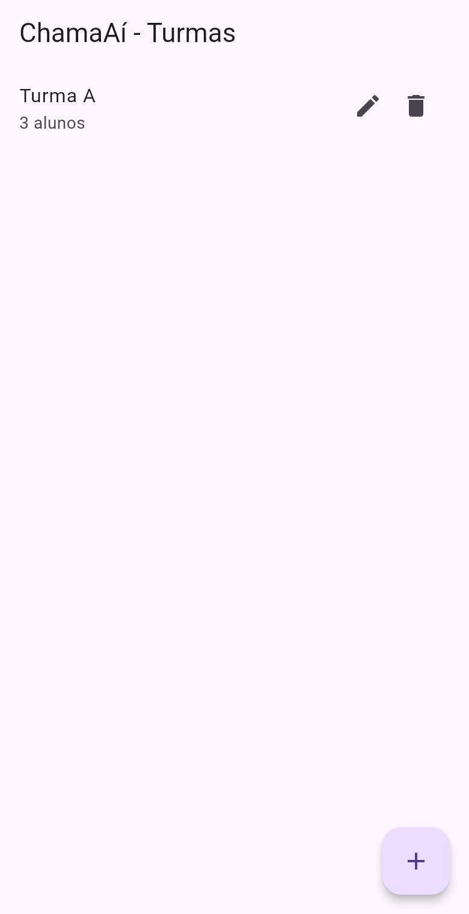
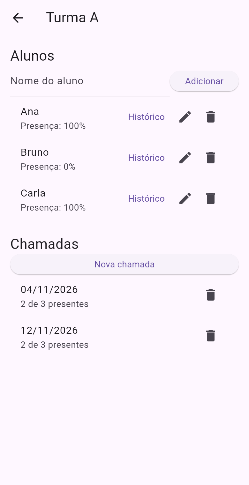
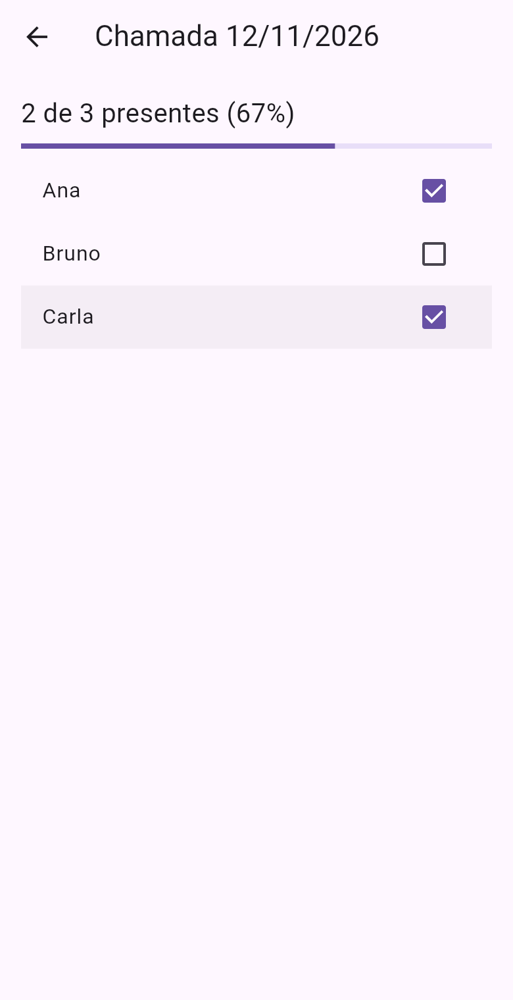

# ChamaAí

App em Flutter/Dart para fazer a chamada de turmas: cadastrar turmas e alunos,
marcar a presença de cada dia e ver o histórico de presença de cada aluno.

| Turmas | Turma | Chamada | Histórico |
|---|---|---|---|
|  |  |  |  |

## O que o app faz

- **Turmas**: criar (botão +), editar o nome (lápis) e remover (lixeira).
- **Alunos**: dentro da turma, adicionar pelo campo de texto, editar o nome e remover.
  Cada aluno mostra o percentual de presença.
- **Chamada**: "Nova chamada" pede a data (já vem preenchida com hoje) e abre a lista
  para marcar quem está presente. Chamadas antigas aparecem na tela da turma e podem
  ser abertas de novo ou removidas.
- **Histórico**: o botão "Histórico" do aluno mostra cada chamada com "Presente" ou
  "Faltou" e o percentual.

Os dados ficam só na memória: ao fechar o app, volta a turma de exemplo.

## Estrutura

```
lib/
  modelos.dart          -> classes Aluno, Chamada e Turma
  main.dart             -> inicia o app; tela com a lista de turmas
  tela_turma.dart       -> alunos e chamadas de uma turma
  tela_chamada.dart     -> marcar presença em uma chamada
  tela_historico.dart   -> histórico de presença de um aluno
  dialogo.dart          -> caixa para digitar um texto (nome ou data)
test/
  widget_test.dart      -> testes (rodar com: flutter test)
prints/                 -> prints do app rodando
Dockerfile              -> compila a versão web e serve com nginx
```

## Como funciona

São três classes:

```dart
class Aluno {
  String nome;
}

class Chamada {
  String data;
  List<Aluno> presentes = [];   // quem veio nesse dia
}

class Turma {
  String nome;
  List<Aluno> alunos = [];
  List<Chamada> chamadas = [];
}
```

Para saber a presença de um aluno, a turma conta em quantas chamadas ele está na lista
de presentes e divide pelo total de chamadas:

```dart
int presencasDoAluno(Aluno aluno) {
  int total = 0;
  for (Chamada chamada in chamadas) {
    if (chamada.estaPresente(aluno)) {
      total++;
    }
  }
  return total;
}

double percentualDoAluno(Aluno aluno) {
  if (chamadas.isEmpty) {
    return 0;
  }
  return presencasDoAluno(aluno) / chamadas.length * 100;
}
```

Toda vez que algo muda (aluno novo, presença marcada...), a mudança é feita dentro de
`setState`, que redesenha a tela.

## Como rodar no seu computador

### Opção 1: com Flutter (para desenvolver)

1. Instale o Flutter seguindo o guia oficial: https://docs.flutter.dev/get-started/install
   (no Windows, o jeito mais fácil é instalar o VS Code + extensão Flutter, que baixa o SDK).
2. Confira se está tudo certo:
   ```bash
   flutter doctor
   ```
   Para rodar no navegador basta ter o Google Chrome. Para Android, precisa do
   Android Studio com um emulador (ou um celular com depuração USB ativada).
3. Clone e rode:
   ```bash
   git clone https://github.com/1fahh/ChamaAi.git
   cd ChamaAi
   flutter pub get
   flutter run -d chrome      # no navegador
   # ou
   flutter devices            # lista celulares/emuladores conectados
   flutter run -d <id>        # roda no aparelho escolhido
   ```
   Com o app rodando, aperte `r` no terminal para recarregar depois de mudar o código
   (hot reload) e `q` para sair.
4. Testes:
   ```bash
   flutter test
   ```

### Opção 2: com Docker (só para ver o app, sem instalar Flutter)

Precisa do [Docker Desktop](https://www.docker.com/products/docker-desktop/).

```bash
git clone https://github.com/1fahh/ChamaAi.git
cd ChamaAi
docker compose up --build
```

Depois abra http://localhost:8080 no navegador. A primeira vez demora alguns minutos
(baixa a imagem do Flutter e compila). Para parar: `Ctrl+C`.

Sem compose:

```bash
docker build -t chamaai .
docker run --rm -p 8080:80 chamaai
```
