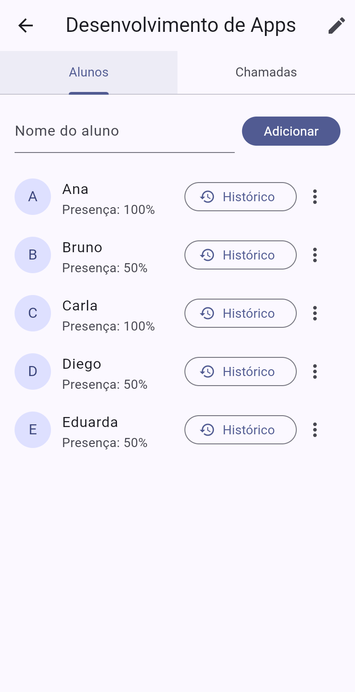
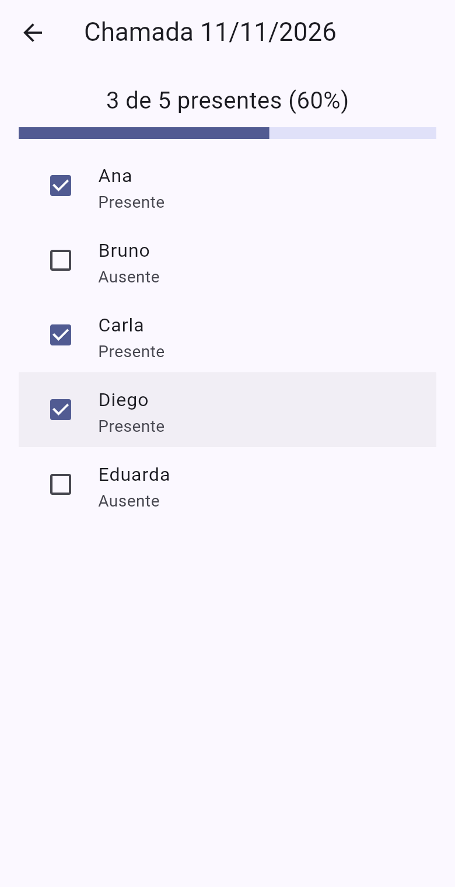
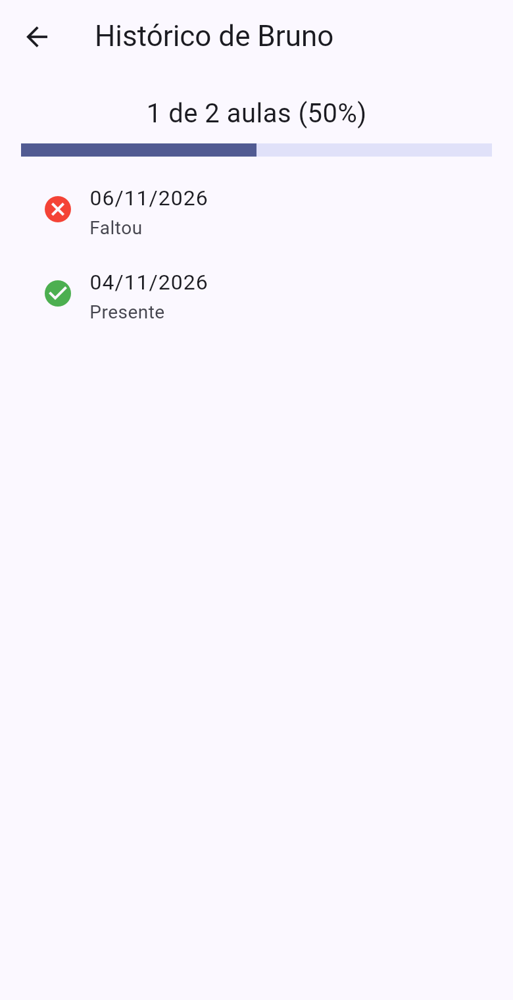

# ChamaAí

App em Flutter/Dart para fazer a chamada de turmas: cadastrar turmas e alunos,
marcar a presença de cada dia e ver o histórico de presença de cada aluno.

| Turmas | Alunos | Chamada do dia | Histórico |
|---|---|---|---|
|  |  |  |  |

## O que o app faz

- **Turmas**: criar, editar o nome e remover (com confirmação).
- **Alunos** (dentro da turma): adicionar; cada aluno mostra "Presença: 50%", um botão
  **Histórico** e o menu **⋮** com *Editar nome* e *Remover*.
- **Chamada por dia**: "Fazer chamada" abre o calendário. Escolhido o dia, marca quem está
  presente e vê "X de Y presentes (Z%)" com barra de progresso. Se já existe chamada
  naquele dia, ela é aberta para editar. Chamadas antigas podem ser abertas ou removidas.
- **Histórico do aluno**: no botão *Histórico* (ou tocando no aluno) aparece cada dia com "Presente" ou "Faltou"
  e o percentual geral.

Os dados ficam só na memória: ao fechar o app, voltam os dados de exemplo.

## Estrutura

```
lib/
  main.dart                  -> inicia o app e cria os dados de exemplo
  modelos.dart               -> classes Aluno, Chamada e Turma
  telas/
    tela_turmas.dart         -> lista de turmas (criar/editar/remover)
    tela_turma.dart          -> abas Alunos e Chamadas de uma turma
    tela_chamada.dart        -> chamada de um dia (marcar presença)
    tela_historico.dart      -> histórico de presença de um aluno
    dialogos.dart            -> caixas de "digite o nome" e "tem certeza?"
test/
  widget_test.dart           -> testes (rodar com: flutter test)
prints/                      -> prints do app rodando
Dockerfile                   -> compila a versão web e serve com nginx
```

## Como funciona a presença por dia

Cada `Chamada` guarda uma data e a lista de alunos presentes naquele dia:

```dart
class Chamada {
  DateTime data;
  List<Aluno> presentes = [];
  bool estaPresente(Aluno aluno) => presentes.contains(aluno);
}
```

O percentual do aluno conta em quantas chamadas ele aparece como presente:

```dart
int presencasDe(Aluno aluno) =>
    chamadas.where((c) => c.estaPresente(aluno)).length;

double percentualDe(Aluno aluno) =>
    chamadas.isEmpty ? 0 : presencasDe(aluno) / chamadas.length * 100;
```

## Como rodar no seu computador

### Opção 1: com Flutter (recomendado para desenvolver)

1. Instale o Flutter seguindo o guia oficial: https://docs.flutter.dev/get-started/install
   (no Windows, o jeito mais fácil é instalar o VS Code + extensão Flutter, que baixa o SDK).
2. Confira se está tudo certo:
   ```bash
   flutter doctor
   ```
   Para rodar no navegador basta ter o Google Chrome. Para Android, precisa do
   Android Studio com um emulador (ou um celular com depuração USB ativada).
3. Clone e rode:
   ```bash
   git clone https://github.com/1fahh/ChamaAi.git
   cd ChamaAi
   flutter pub get
   flutter run -d chrome      # no navegador
   # ou
   flutter devices            # lista celulares/emuladores conectados
   flutter run -d <id>        # roda no aparelho escolhido
   ```
   Com o app rodando, aperte `r` no terminal para recarregar depois de mudar o código
   (hot reload) e `q` para sair.
4. Testes:
   ```bash
   flutter test
   ```

### Opção 2: com Docker (só para ver o app, sem instalar Flutter)

Precisa do [Docker Desktop](https://www.docker.com/products/docker-desktop/).

```bash
git clone https://github.com/1fahh/ChamaAi.git
cd ChamaAi
docker compose up --build
```

Depois abra http://localhost:8080 no navegador. A primeira vez demora alguns minutos
(baixa a imagem do Flutter e compila). Para parar: `Ctrl+C`.

Sem compose:

```bash
docker build -t chamaai .
docker run --rm -p 8080:80 chamaai
```

O Docker gera a versão **web** do app. Para mexer no código e ver as mudanças na hora,
use a opção 1.
